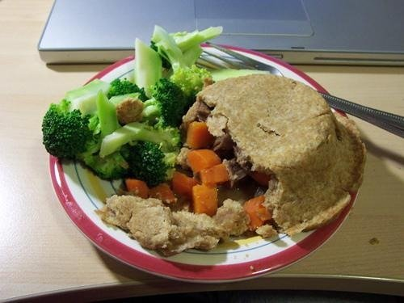

<div align="center">

# MiniQwen-Omni

</div>

<div align="center">

[](LICENSE)
[](https://modelscope.cn/models/peachPPP)
[](https://modelscope.cn/datasets/peachPPP)

</div>

<div align="center">
  <h3>让一个轻量级模型同时听、看、理解并说话</h3>
</div>

<div align="center">

中文 | [English](./README_en.md)

</div>

- MiniQwen-Omni 是一个基于 Qwen3-0.6B Thinker 的端到端 Omni 模型，统一处理文本、语音和图像输入，并生成文本与 Mimi 语音。
- 项目公开完整的模型代码、数据处理流程、Pretrain/SFT 训练器、评测脚本和 ModelScope 发布流程。
- 当前发布两个连续训练版本：`MiniQwen-Omni-V1-Base`（Pretrain）和 `MiniQwen-Omni-V1`（SFT）。
- 音频输入使用冻结的 SenseVoice，视觉输入使用冻结的 SigLIP2，语音输出使用 Mimi 8 层 codec codes。
- 训练、推理、数据和评测接口保持一致，下载发布数据和模型后可以直接复现训练或推理。

---

# 🧭 项目介绍

MiniQwen-Omni 的目标，是用相对小的语言主干跑通一条完整的文本、语音、视觉 Omni 链路。语音不被简单地拆成“ASR → LLM → TTS”三级服务，而是先经过 SenseVoice 提取音频特征，再进入 Thinker 的统一序列；Talker 根据 Thinker 的中间层语义条件直接生成 Mimi audio codes。图像经过 SigLIP2 和 vision projector 注入同一条序列，文本、语音和图像因此可以在一个模型中共同参与理解。

模型采用 Thinker–Talker 双路径：Thinker 负责多模态理解和文本输出，Bridge 将中间层 hidden state 投影到 Talker，Talker 负责语音 codebook 预测。声音克隆通过 speaker embedding 和 reference audio codes 提供条件，推理时替换条件即可切换预设音色或参考说话人。

项目不把当前结果包装成通用能力榜单。小模型在长文本推理、复杂知识问答、开放式视觉推理和长语音自然度上仍然有限；这里更关注一条可检查、可训练、可继续改进的 Omni 基线。

#### 🎉 项目包含以下内容

- Qwen3-0.6B Thinker、Bridge、独立 Talker、audio/vision projector 和 Mimi codebook head 的完整实现。
- Audio、Vision、TTS 三阶段 Pretrain 与全参数 SFT 训练流程，支持 CUDA DDP 和断点续训。
- AIA、IIA、AOA 三类 Pretrain Parquet，以及带媒体路径的混合 SFT Parquet。
- 无参考语音、speaker-only、reference-only、speaker + reference 和预设音色推理接口。
- ASR、Audio→Text、TTS、图像理解、双图理解、音色克隆和 UTMOS 评测流程。
- ModelScope 模型和数据集下载脚本，下载后直接落到 `out/`、`dataset/` 和 `model/` 默认目录。

#### 🎉 已发布模型

| 模型 | 阶段 | 用途 |
|---|---|---|
| [MiniQwen-Omni-V1-Base](https://modelscope.cn/models/peachPPP/MiniQwen-Omni-V1-Base) | Audio/Vision/TTS Pretrain | 继续 SFT 或研究模态对齐 |
| [MiniQwen-Omni-V1](https://modelscope.cn/models/peachPPP/MiniQwen-Omni-V1) | Pretrain + SFT | 默认推理和 Web Demo |

### 参数规模

| 模型 | 参数规模 |
|---|---:|
| MiniQwen-Omni-V1 | 0.7B |
| Mini-Omni2 | 0.5B |
| MiniMind-3O-MoE | 0.3B |
| Qwen2.5-Omni-3B | 3B |


#### 🔗 数据集

| 数据集 | 内容 |
|---|---|
| [MiniQwen-Omni-V1-Pretrain](https://modelscope.cn/datasets/peachPPP/MiniQwen-Omni-V1-Pretrain) | AIA、IIA、AOA 处理后 Parquet |
| [MiniQwen-Omni-V1-SFT](https://modelscope.cn/datasets/peachPPP/MiniQwen-Omni-V1-SFT) | 混合 SFT Parquet 和引用媒体 |

# 🚀 快速开始

## 第 0 步（必须）

### 1' 环境准备

建议使用 **8 张 NVIDIA H20（96 GB）**，CUDA 12.4 或兼容版本，训练采用 CUDA DDP。

```bash
git clone --depth 1 https://github.com/peachPPP/miniqwen-omni
cd miniqwen-omni
python3 -m venv .venv
source .venv/bin/activate
python -m pip install --upgrade pip
pip install -r requirements.txt
```

### 2' 下载数据和发布模型

登录 ModelScope 后执行一条命令：

```bash
bash scripts/download_modelscope_release.sh
python scripts/validate_downloaded_release.py
```

完成后目录如下：

```text
miniqwen-omni/
├── dataset/
│   ├── pretrain/
│   ├── sft/
│   └── raw/external/
├── out/
│   ├── miniqwen_pretrain/tts/last/checkpoint/
│   └── miniqwen_sft/last/checkpoint/
└── model/
    ├── Qwen3-0.6B/
    ├── SenseVoiceSmall/
    ├── siglip2-base-p32-256-ve/
    └── mimi/
```

### 3' 下载训练依赖模型

```bash
modelscope download --model Qwen/Qwen3-0.6B --local_dir model/Qwen3-0.6B
modelscope download --model iic/SenseVoiceSmall --local_dir model/SenseVoiceSmall
modelscope download --model iic/speech_campplus_sv_zh-cn_16k-common --local_dir model/campplus

# SigLIP2 原始来源
huggingface-cli download google/siglip2-base-patch32-256 \
  --local-dir /tmp/siglip2-base-patch32-256

# Mimi 原始来源
huggingface-cli download kyutai/mimi --local-dir /tmp/mimi
```

项目使用的开源原始数据集：

- [LibriSpeech / OpenSLR 12](https://www.openslr.org/12/)
- [LibriTTS-R / OpenSLR 141](https://www.openslr.org/141/)
- [AISHELL-1 / OpenSLR 33](https://www.openslr.org/33/)
- [AISHELL-3 / OpenSLR 93](https://www.openslr.org/93/)
- [LLaVA-Pretrain](https://huggingface.co/datasets/liuhaotian/LLaVA-Pretrain)

原始数据只用于重建和追溯；通常直接下载处理后的 ModelScope 数据集即可。

# 🎙️ Ⅰ 模型推理

### 1' 命令行推理

```bash
python eval_omni.py \
  --load_from out/miniqwen_sft/last/checkpoint \
  --mode -1 --max_samples 1
```

`--mode`：

```text
0   text
1   multi-turn
2   audio
3   voice clone
4   image
5   mixed text/audio/image
-1  all
```

不提供参考音色时使用模型原始声音；参考音频最多约 12 秒。预设音色包括 `dylan`、`eric`、`serena`、`uncle_fu` 和 `vivian`，另有 zero-shot 音色可用于评估。

### 2' 语音克隆

```bash
python eval_omni.py \
  --load_from out/miniqwen_sft/last/checkpoint \
  --mode 3 --max_samples 1
```

输入可以包含 reference audio、speaker embedding，或两者同时提供。完整训练和推理接口见 `model/voice_conditioning.py` 与 `scripts/web_demo_omni.py`。

### 3' Web Demo

```bash
read -rsp 'Web password: ' MINIQWEN_WEB_PASSWORD
echo
export MINIQWEN_WEB_PASSWORD
bash scripts/serve_web.sh
```

Web Demo 支持文本、麦克风、单图、多图、多轮对话、流式文本、文字 + 语音回复、预设音色和参考音频克隆。详细部署说明见 `WEB_DEPLOYMENT.md`。

# 🛠️ Ⅱ 模型训练

### 1' Pretrain

```bash
bash trainer/pretrain.sh --run
```

### 2' SFT

使用已有 Pretrain checkpoint：

```bash
bash trainer/sft.sh --run
```

使用从 ModelScope 下载的 V1-Base：

```bash
bash trainer/sft.sh --run \
  --checkpoint out/miniqwen_pretrain/tts/last/checkpoint
```

训练计划：

| 阶段 | Epoch | 解冻模块 | 学习率 | 目标 |
|---|---:|---|---:|---|
| Audio | 2 | Audio projector | 3e-4 | 音频输入对齐 |
| Vision | 2 | Vision projector | 3e-4 | 视觉输入对齐 |
| TTS | 3 | Talker | 2e-4 | 语音输出对齐 |
| SFT | 2 | Thinker、文本头、Talker、Audio/Vision projector、speaker projector | Thinker 1e-6；Omni 1e-5；speaker 2e-5 | 多模态融合、指令遵循和能力保持 |

训练支持断点续训，checkpoint 保存模型、优化器、RNG 和采样进度。ModelScope 发布的 BF16 权重不包含 optimizer 和 trainer state。

# 🧩 模型细节

## Ⅰ 架构总览

```text
Text ────────────────┐
Speech ─ SenseVoice ─┼─> Qwen3-0.6B Thinker ─> text output
Image ─ SigLIP2 ────┘              │
                                   ▼
                            Bridge / Talker
                                   │
                            Mimi 8-code output
```

Thinker 统一接收文本、语音和图像信息；中间层 Bridge 将语义 hidden state 映射到 Talker；Talker 预测 Mimi 的 8 层 codebook。SenseVoice、SigLIP2 和 Mimi 在正式训练中冻结。

## Ⅱ Thinker 侧多模态理解

Qwen3-0.6B Thinker 负责文本理解、语音理解、图像理解和文本生成。音频特征经过 512 → 1024 projector，视觉特征经过 768 → 1024 projector，最终与文本 token 在同一序列中建模。SFT 阶段解冻 Thinker，学习多模态输入和指令格式之间的关系。

## Ⅲ 中间层 Bridge

Bridge 默认读取 Thinker 中间层 hidden state，再投影到 Talker 的 768 维空间。中间层同时保留上下文信息和跨模态融合结果，比 embedding 层更有语义，也比最后一层更少受到纯文本 LM head 目标的限制。

## Ⅳ Talker 侧语音生成

Talker 使用 Main codec head 预测 Mimi c0，再由 Code Predictor 自回归预测 c1–c7。8 层 codebook 的平均表示在后续 Talker 步骤中反馈，最后由 Mimi decoder 还原为 24 kHz 波形。

## Ⅴ 序列格式与监督区域

训练样本由文本 token、音频输入占位符、图像 token、speaker/reference 条件和目标文本/音频组成。reference audio 与 speaker embedding 只作为条件，不参与目标重构；assistant 文本和目标 Mimi codes 才计算监督损失。多轮样本支持 `all_assistant_text` 和 `all_text_last_audio` 监督策略。

## Ⅵ 音色控制

音色控制采用条件输入方式：

- **无参考**：不提供 speaker 或 reference，使用模型原始声音。
- **speaker-only**：只提供 CAMPPlus speaker embedding。
- **reference-only**：只提供 Mimi reference codes。
- **speaker + reference**：同时提供两类条件，通常最完整。
- **预设音色**：直接加载 dylan、eric、serena、uncle_fu、vivian 等条件。

训练时会对 speaker/reference 条件做确定性随机丢弃，让模型同时学习有参考和无参考路径。

## Ⅶ 模块与参数规模

| 模块 | 参数规模 | 配置与训练状态 |
|---|---:|---|
| Thinker + LM head | 596.0M | Qwen3-0.6B，28 layers，hidden 1024；Pretrain 分阶段冻结，SFT 解冻 |
| Talker core | 84.3M | 6 layers，hidden 768；TTS/SFT 解冻 |
| Bridge | 1.8M | Thinker hidden → Talker hidden；随 Talker 训练 |
| Codec projection | 1.2M | Mimi code embedding projection；随 Talker 训练 |
| Audio projector | 1.6M | 512 → 1024；Audio/SFT 解冻 |
| Vision projector | 1.8M | 768 → 1024；Vision/SFT 解冻 |
| Speaker projector | 0.15M | CAMPPlus 192-d → Talker；SFT 使用独立学习率 |
| SenseVoice | 234.0M（外置） | speech encoder，冻结 |
| SigLIP2 | 94.6M（外置） | vision encoder，冻结 |
| Mimi | 96.2M（外置） | 8 codebooks，12.5 Hz，24 kHz，冻结 |
| CAMPPlus | 6.9M（外置） | 192-d speaker embedding，作为条件输入 |

# 🗃️ 数据集

## Ⅰ Pretrain 数据

Pretrain 处理后数据分为三类：

- **AIA**：Audio Input Alignment，音频输入和 ASR/语音理解。
- **IIA**：Image Input Alignment，图像输入和图像理解。
- **AOA**：Audio Output Alignment，文本到语音、TTS 和音色条件。

```text
dataset/pretrain/AIA
dataset/pretrain/IIA
dataset/pretrain/AOA
```

Parquet 已内嵌音频 bytes、codec codes、speaker 条件和统一 schema，训练时不需要重新读取压缩包。

## Ⅱ SFT 数据

SFT 数据包含：

- 纯文本指令和多轮对话
- 单图和多图理解
- 图像 + 语音问题
- ASR、TTS、Audio→Text 和声音克隆条件
- 2048 主长度池和 3072 长文本池

```text
dataset/sft/main_2048
dataset/sft/long_text_3072
dataset/raw/external
```

SFT 媒体使用相对于项目根目录的路径，下载数据集时必须保留 `raw/external` 目录。

# 📊 实验与评估

以下结果只汇报最终模型 **MiniQwen-Omni-V1** 与外部模型的对比。评测使用同一份 v2.4 standard manifest（不含纯文本回归）、同一套 scorer 和 SenseVoice-Small 评分器；Audio→Audio QA 已从正式评测中移除，只保留 Audio→Text QA。

## ASR：clean 与 other

ASR clean 使用 LibriSpeech test-clean，录音更干净、说话条件更稳定；ASR other 包含更多噪声、口音和录音变化，难度更高。两者都使用 WER，数值越低越好。

| 模型 | clean WER ↓ | other WER ↓ |
|---|---:|---:|
| **MiniQwen-Omni-V1** | **5.07%** | **11.19%** |
| Mini-Omni2 | 4.43% | 7.97% |
| MiniMind-3O-MoE | 405.01% | 361.77% |
| Qwen2.5-Omni-3B | 6.13% | 5.37% |

V1 在 clean 上接近 Qwen2.5-Omni-3B，在 other 上仍有差距，但明显优于 MiniMind-3O-MoE。

**样例（ASR clean）**

完整指令：
```text
Transcribe the speech exactly in English.
```


https://github.com/user-attachments/assets/90d2b0ec-2ee7-4640-8f43-37e4f1269771

V1 转写：`SIR MARCH SIXTEENTH`


**样例（ASR other）**

完整指令：
```text
Transcribe the speech exactly in English.
```


https://github.com/user-attachments/assets/125c8a2a-865a-49e3-8717-5aa454224f0f

V1 转写：`ALMOST AT THIS INSTANT I HEARD A PISTOL SHOT IN THE BANK`


## Audio → Text QA

这是语音问题到文本答案的多项选择任务，输入是 spoken question，输出只计文本答案。标准评测中的 spoken question 由 Kokoro-82M 将题目文本合成为语音，用于固定输入条件。

| 模型 | 正确率 ↑ |
|---|---:|
| **MiniQwen-Omni-V1** | **32.50%** |
| Mini-Omni2 | 13.75% |
| MiniMind-3O-MoE | 5.00% |
| Qwen2.5-Omni-3B | 91.25% |

样例：对于一个要求只输出选项字母的问题，V1 会输出 `B` 或 `Answer: C`；评分器支持明确的 `Answer: C` 格式，也支持唯一匹配的选项文本。

**样例**

题目通过语音输入：


https://github.com/user-attachments/assets/e29f70ad-22d6-46f2-8500-b5cdb6fb1088


V1 文本回答：`A`

## TTS 内容与自然度

TTS WER 衡量生成语音经 SenseVoice 转写后与目标文本的差异，数值越低越好。这里的 TTS 使用各模型官方默认音色和推理配置：V1 不提供 speaker/reference，Qwen2.5-Omni-3B 使用官方 Chelsie 预设音色。

| 模型 | TTS WER ↓ | UTMOS ↑ |
|---|---:|---:|
| **MiniQwen-Omni-V1** | **22.38%** | **3.284** |
| Mini-Omni2 | 161.32% | **4.386** |
| MiniMind-3O-MoE | 122.74% | **3.638** |
| Qwen2.5-Omni-3B | 22.54% | **4.291** |

V1 的 TTS 内容准确率与 Qwen2.5-Omni-3B 接近。WER 依赖统一 ASR 评分器，UTMOS 只表示自然度，不能单独代表内容正确性。UTMOS 对每个模型的 64 条 TTS 输出使用同一 SpeechMOS/UTMOS22 strong 模型计算。

**样例**

完整指令：
```text
Read the following text exactly and do not add commentary:
What I say is altogether on your own account.
```


https://github.com/user-attachments/assets/381ca461-fa08-4cc4-be26-81550a4354e4

TTS 其他输出示例：

- `v1-audio-answer.mp4`
  https://github.com/user-attachments/assets/696772d4-7005-4602-8b1d-7f21e7342c93
- `v1-base-tts.mp4`
  https://github.com/user-attachments/assets/d9e2bca4-25d7-41db-8b9e-6e5640886bae
- `v1-tts.mp4`
  https://github.com/user-attachments/assets/61b3900f-5466-4cff-860e-e137636034f8


## MMBench-EN

MMBench-EN 测试图像多项选择、知识理解和格式遵循。

| 模型 | 正确率 ↑ |
|---|---:|
| **MiniQwen-Omni-V1** | **38.33%** |
| Mini-Omni2 | N/A（公开接口要求图像 + 语音问题） |
| MiniMind-3O-MoE | 10.00% |
| Qwen2.5-Omni-3B | 82.50% |

**样例**

完整指令：
```text
Which Python code can generate the content of the image?
A. import re
result = re.match(r'(\w+)=(\d+)', 'set width=20 and height=10')
print(result)
B. import re
result = re.findall(r'(\w+)=(\d+)', 'set width=20 and height=10')
print(result)
C. import re
result = re.findall(r'(\w+)=(\d+)', 'set width=30 and height=10')
print(result)
D. import re
result = re.findall(r'(\w+)=(\d+)', 'set width=20 and height=15')
print(result)
Answer with only the option letter.
```


V1 输出：`B`

## POPE

POPE 测试图像问答中的对象存在性判断，报告 F1。

| 模型 | F1 ↑ |
|---|---:|
| **MiniQwen-Omni-V1** | **60.00%** |
| Mini-Omni2 | N/A（公开接口协议不支持纯图像输入） |
| MiniMind-3O-MoE | 0.00% |
| Qwen2.5-Omni-3B | 94.74% |

**样例**

完整指令：
```text
Is there a fork in the image?
A. Yes
B. No
Answer with only the option letter.
```



V1 输出：`A`

## TextVQA / OCR

TextVQA 关注场景文字、价格、品牌、标牌和短字段读取。

| 模型 | 准确率 ↑ |
|---|---:|
| **MiniQwen-Omni-V1** | **11.11%** |
| Mini-Omni2 | N/A（公开接口协议不支持纯图像输入） |
| MiniMind-3O-MoE | 3.89% |
| Qwen2.5-Omni-3B | 80.56% |

**样例**

完整指令：
```text
who is wanted in the army?
Answer using a short phrase only.
```


V1 输出：`I want you for the army`

## 图像 + 语音问题

该任务同时提供图像和 spoken question，测试跨模态融合。图片来自 MMBench-EN dev，spoken question 由 Kokoro-82M 使用 `af_heart` voice pack 合成。

| 模型 | 正确率 ↑ |
|---|---:|
| **MiniQwen-Omni-V1** | **26.56%** |
| Mini-Omni2 | 7.81% |
| MiniMind-3O-MoE | 0.00% |
| Qwen2.5-Omni-3B | 81.25% |

**样例**

题目通过语音输入：


https://github.com/user-attachments/assets/e1dcd3da-f443-460e-a12c-6a0b9743af6c


语音问题对应的文字内容：

```text
How many people can you see in this picture?
A. eight
B. ten
C. four
D. one
Answer with only the option letter.
```

V1 文本输出：`The number of people visible in the picture is 4.`

## NLVR2 双图

NLVR2 要求比较两张图像并判断文本描述是否成立。

| 模型 | 正确率 ↑ |
|---|---:|
| **MiniQwen-Omni-V1** | **53.12%** |
| Mini-Omni2 | N/A |
| MiniMind-3O-MoE | N/A |
| Qwen2.5-Omni-3B | 84.38% |

**样例**

完整指令：
```text
All the crabs are out of the water.
A. True
B. False
Answer with only the option letter.
```

 

V1 输出：`A`


## 音色克隆相似度

音色克隆使用独立 speaker verification 模型计算 speaker cosine，只比较能接收 reference audio / speaker condition 的模型。

| 模型 | Speaker cosine ↑ |
|---|---:|
| **MiniQwen-Omni-V1** | **0.1568** |
| MiniMind-3O-MoE | 0.1361 |
| Qwen2.5-Omni-3B | N/A（公开接口使用预设音色） |
| Mini-Omni2 | N/A（公开接口没有同协议的任意参考音频条件） |

**样例**

完整指令：
```text
请使用参考音频中的说话人音色，朗读指定文本。
```

参考音频：

https://github.com/user-attachments/assets/494ec964-5cdb-47b9-ba82-5bece491a443


V1 输出：

https://github.com/user-attachments/assets/40735bb5-d6fd-4ae7-a5d2-5066705e5d9f


Speaker cosine：`0.1568`

# 🧱 项目结构

```text
miniqwen-omni/
├── model/          Qwen3、SenseVoice、SigLIP2、Mimi 和 speaker encoder
├── out/            V1/V1-Base 训练或下载 checkpoint
├── dataset/        raw、pretrain、sft 和 Parquet 数据
├── data_pipeline/  下载、清洗、编码、切分和验收
├── trainer/        Pretrain/SFT 训练器、采样器和 checkpoint
├── benchmark/      standard/quick 评测和外部模型适配器
├── scripts/        下载、启动、推理、导出和服务
├── tests/          单元、数据、smoke 和 benchmark 测试
└── examples/       README 音频和图片示例
```

# 📦 发布

导出 BF16 模型：

```bash
python scripts/export_modelscope.py \
  --checkpoint out/miniqwen_sft/last/checkpoint \
  --output releases/MiniQwen-Omni-V1 \
  --model-name MiniQwen-Omni-V1 \
  --repo-id peachPPP/MiniQwen-Omni-V1
```

数据 staging、ModelScope 仓库创建、上传和下载验证见 `PUBLISHING.md`。GitHub 只提交代码和小型示例；完整数据、模型、日志和评测产物发布到 ModelScope。

# 🔭 未来值得改进的方面

当前主要短板集中在四个方向：

1. 长文本和长语音输出的内容稳定性；
2. 图像 + 语音融合任务的指令遵循；
3. 声音克隆的内容保持、自然度和跨说话人泛化；
4. 视觉 OCR、细粒度关系和多图推理。

后续可以从更大规模的多轮音频监督、更干净的声音克隆配对、Thinker/Bridge/Talker 解冻策略和更严格的跨数据集去污染评测继续改进。

# 🙏 许可证和致谢

代码使用 Apache-2.0。Qwen3、SenseVoice、SigLIP2、Mimi、CAMPPlus 和开源语料遵循各自上游许可证，使用和再发布时请保留原始作者与许可证信息。

本项目参考了 [MiniMind-O](https://github.com/jingyaogong/minimind-o) 的数据组织和训练接口，也参考了 [Qwen3-Omni](https://github.com/QwenLM/Qwen3-Omni) 的多模态序列与 Thinker–Talker 系统设计。项目使用 Qwen3-0.6B 作为 Thinker，并独立实现了适配 Mimi 8-codebook 输出的 Talker、Bridge 和音频条件模块。
