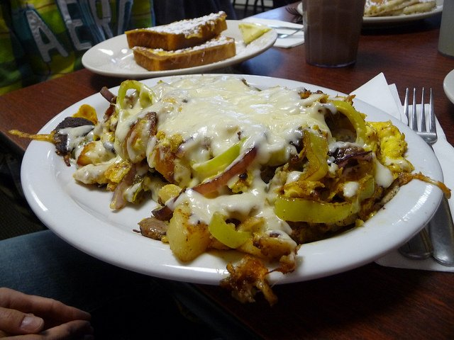
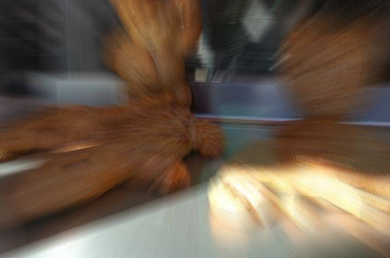
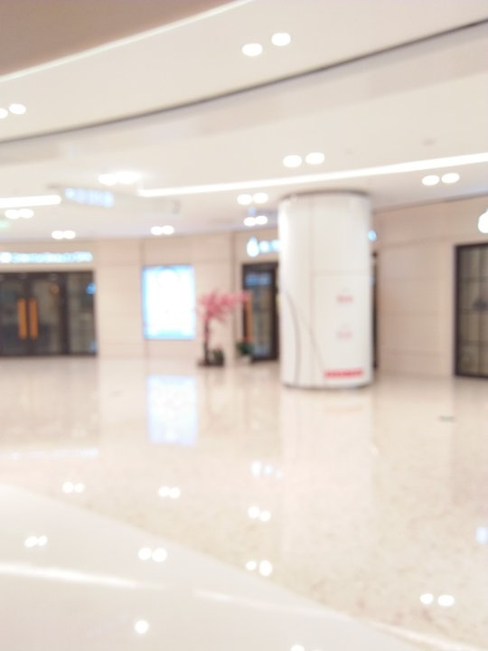

<div align="center">

# MiniQwen-Omni

**An end-to-end text, speech, and vision Omni model built on Qwen3-0.6B**

[](LICENSE)
[](https://modelscope.cn/)

**MiniQwen-Omni-V1-Base** · pretraining complete<br>
**MiniQwen-Omni-V1** · full SFT on V1-Base

</div>

## Demo

The repository includes small playable WAV examples. Open the GitHub page and click the controls.

| Scenario | Input | Output |
|---|---|---|
| Unconditioned TTS | `This outward mutability indicated ...` | <audio controls preload="metadata"><source src="examples/audio/v1-tts.wav" type="audio/wav"></audio> |
| Base unconditioned TTS | same text | <audio controls preload="metadata"><source src="examples/audio/v1-base-tts.wav" type="audio/wav"></audio> |
| Spoken QA | `What is an example of a chemical reaction?` | <audio controls preload="metadata"><source src="examples/audio/v1-audio-answer.wav" type="audio/wav"></audio> |

Fallback links: [V1 TTS](examples/audio/v1-tts.wav) · [V1-Base TTS](examples/audio/v1-base-tts.wav) · [V1 spoken QA](examples/audio/v1-audio-answer.wav).

<p></p>

## Task leaderboard

All models use the same 640-sample standard manifest and scorer 2.3.0. WER is lower-is-better; all other metrics are higher-is-better. N/A means that the public interface does not support the task.

| Task | V1-Base | V1 | Mini-Omni2 | MiniMind-3O-MoE | Qwen2.5-Omni-3B |
|---|---:|---:|---:|---:|---:|
| ASR clean WER | 5.80% | 6.35% | 4.43% | 498.93% | 6.13% |
| ASR other WER | 11.74% | 11.67% | 7.97% | 406.41% | 5.37% |
| Audio → Text QA | 13.75% | 17.50% | 13.75% | 5.00% | 91.25% |
| TTS WER | 24.92% | **16.82%** | 161.32% | 210.02% | 22.54% |
| MMBench-EN | 24.17% | **40.00%** | N/A | 8.33% | 82.50% |
| POPE F1 | **68.97%** | 61.97% | N/A | 0.00% | 94.74% |
| TextVQA | 5.56% | **11.11%** | N/A | 1.11% | 80.56% |
| Image + spoken question | **21.88%** | 9.38% | 7.81% | 3.12% | 76.56% |
| NLVR2 multi-image | 18.75% | **53.12%** | N/A | N/A | 84.38% |

Mini-Omni2's public vision interface requires image plus a spoken question, so MMBench-EN, POPE, and TextVQA cannot be called fairly with plain text. V1 unconditioned TTS UTMOS is 3.284. The same UTMOS22 scorer gives 4.386 for Mini-Omni2, 3.638 for MiniMind-3O-MoE, and 4.291 for Qwen2.5-Omni-3B. On the 16-sample voice-clone set, V1 reaches speaker cosine 0.1767, content score 49.50%, and UTMOS 2.843.

## Model sizes

| Model | Parameters |
|---|---:|
| MiniQwen-Omni-V1 | 0.7B |
| Mini-Omni2 | 0.5B |
| MiniMind-3O-MoE | 0.3B |
| Qwen2.5-Omni-3B | 3B |

## Architecture

```text
Text ───────────────┐
Speech ─ SenseVoice ─┼─> Qwen3-0.6B Thinker ─> text output
Image ─ SigLIP2 ────┘              │
                                   ▼
                            Bridge / Talker
                                   │
                            Mimi 8-code output
```

- Qwen3-0.6B Thinker: 28 layers, hidden size 1024.
- Frozen SenseVoice audio encoder with a 512 → 1024 projector.
- Frozen SigLIP2 vision encoder with a 768 → 1024 projector and 64 image tokens per image.
- Six-layer, 768-wide Talker; Main head predicts c0 and Code Predictor autoregressively predicts c1–c7.
- External frozen weights are approximately SenseVoice 234.0M, SigLIP2 94.6M, Mimi 96.2M, CAMPPlus 6.9M, and ERes2Net 6.6M.

## Quick start

Recommended training hardware is **8× NVIDIA H20 (96 GB)** with CUDA 12.4 or a compatible CUDA runtime. Training uses CUDA DDP.

```bash
python3 -m venv .venv
source .venv/bin/activate
pip install -r requirements.txt
bash scripts/download_modelscope_release.sh
python scripts/validate_downloaded_release.py
python eval_omni.py --load_from out/miniqwen_sft/last/checkpoint --mode -1 --max_samples 1
```

The download script places prepared data under `dataset/` and the two trained models under their default `out/` checkpoint paths. Original public sources are listed here for reproducibility: [LibriSpeech](https://www.openslr.org/12/), [LibriTTS-R](https://www.openslr.org/141/), [AISHELL-1](https://www.openslr.org/33/), [AISHELL-3](https://www.openslr.org/93/), and [LLaVA-Pretrain](https://huggingface.co/datasets/liuhaotian/LLaVA-Pretrain).

Optional base-model downloads. Qwen3 and SenseVoice can be placed directly in the training tree; SigLIP2 and Mimi require the project-compatible vision/codec format:

```bash
modelscope download --model Qwen/Qwen3-0.6B --local_dir model/Qwen3-0.6B
modelscope download --model iic/SenseVoiceSmall --local_dir model/SenseVoiceSmall
# SigLIP2 source: https://huggingface.co/google/siglip2-base-patch32-256
huggingface-cli download google/siglip2-base-patch32-256 --local-dir /tmp/siglip2-base-patch32-256
# Mimi source: https://huggingface.co/kyutai/mimi
huggingface-cli download kyutai/mimi --local-dir /tmp/mimi
# CAMPPlus: https://www.modelscope.cn/models/iic/speech_campplus_sv_zh-cn_16k-common
modelscope download --model iic/speech_campplus_sv_zh-cn_16k-common --local_dir model/campplus
```

Keep auxiliary models in `model/Qwen3-0.6B`, `model/SenseVoiceSmall`, `model/siglip2-base-p32-256-ve`, and `model/mimi`. Reference cloning additionally needs CAMPPlus/ERes2Net and preset voices.

The inference modes are `0=text`, `1=multi-turn`, `2=audio`, `3=clone`, `4=image`, `5=mix`, and `-1=all`. Without a reference voice the model uses its native voice; reference audio is supported up to about 12 seconds.

### Web demo

```bash
read -rsp 'Web password: ' MINIQWEN_WEB_PASSWORD; echo
export MINIQWEN_WEB_PASSWORD
bash scripts/serve_web.sh
```

The demo supports text, microphone, images, multi-turn context, streaming text, speech replies, and preset voices.

## Training

```bash
bash trainer/pretrain.sh --run
bash trainer/sft.sh --run
```

| Stage | Epochs | Batch/device | Accumulation |
|---|---:|---:|---:|
| Audio | 2 | 8 | 1 |
| Vision | 2 | 8 | 1 |
| TTS | 3 | 8 | 1 |
| SFT | 2 | 4 | 2 |

The resumable checkpoints preserve model, optimizer, RNG, and sampler state.

```text
MiniQwen-Omni-V1-Base = out/miniqwen_pretrain/tts/last/checkpoint
MiniQwen-Omni-V1      = out/miniqwen_sft/last/checkpoint
```

## Repository layout

```text
model/          model, Talker, audio/vision projectors
dataset/        runtime readers and Parquet data
data_pipeline/ offline download, cleaning, encoding, and validation
trainer/        canonical Pretrain/SFT engines and checkpoints
benchmark/      standard/quick evaluation and model adapters
scripts/        launch, inference, export, and serving commands
tests/          unit, data, smoke, and benchmark tests
examples/       README audio and image examples
```

## Evaluation and export

```bash
bash scripts/run_omni_benchmark.sh standard
bash scripts/run_voice_clone_benchmark.sh <run_id>
python -m unittest discover -s tests -p 'test_*.py'
python scripts/export_modelscope.py --checkpoint out/miniqwen_sft/last/checkpoint --output releases/MiniQwen-Omni-V1
```

Full datasets, auxiliary models, checkpoints, caches, and complete evaluation artifacts are excluded from Git. Code is published to GitHub; models and data are published to ModelScope.

## Attribution

This project references the data organization and training interfaces of [MiniMind-O](https://github.com/jingyaogong/minimind-o), and the multimodal sequence and Thinker–Talker system design of [Qwen3-Omni](https://github.com/QwenLM/Qwen3-Omni). It uses Qwen3-0.6B as the Thinker and implements its Mimi 8-codebook Talker, Bridge, and audio-conditioning modules independently.
